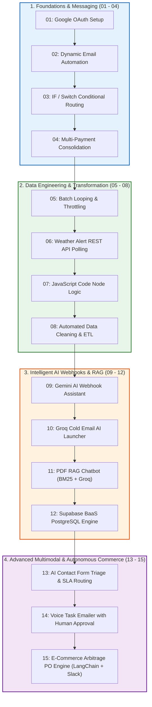

# 🚀 Production n8n Workflows Collection & Technical Reports

[](https://github.com/maheenazhar)
[](#)
[](https://n8n.io)
[](#)
[](#)

A master portfolio and curated library of **15 production-ready n8n workflows** built by **[Maheen Azhar](https://github.com/maheenazhar)**. This collection spans foundational integrations, advanced data engineering, multi-channel alerting, and enterprise-grade autonomous AI agent systems.

Each workflow is organized sequentially in its own dedicated directory and published as an independent, modular GitHub repository complete with architecture diagrams, node breakdowns, setup instructions, and an exhaustive **Technical Working & Operational Report (`REPORT.md`)**.

---

## 📚 Workflow Catalog, Repositories & Working Reports

| # | Workflow Name & Dedicated Repo | Local Folder | Technical Report | Domain / Category | Level |
|---|-------------------------------|--------------|------------------|-------------------|-------|
| `#01` | [OAuth Authentication & Google Sheets Test](https://github.com/maheenazhar/n8n-01-oauth) | [`01-oauth/`](./01-oauth) | [📄 Read Report](./01-oauth/REPORT.md) | Foundations & Integrations | `Beginner` |
| `#02` | [Dynamic Email Task Automation](https://github.com/maheenazhar/n8n-02-dynamic-email-task) | [`02-dynamic-email-task/`](./02-dynamic-email-task) | [📄 Read Report](./02-dynamic-email-task/REPORT.md) | Email & Google Workspace | `Beginner` |
| `#03` | [Conditional Routing with IF & Switch Nodes](https://github.com/maheenazhar/n8n-03-if-switch-nodes) | [`03-if-switch-nodes/`](./03-if-switch-nodes) | [📄 Read Report](./03-if-switch-nodes/REPORT.md) | Control Flow & Logic | `Intermediate` |
| `#04` | [Multi-Payment Method Dispatcher & Consolidation](https://github.com/maheenazhar/n8n-04-multi-payment) | [`04-multi-payment/`](./04-multi-payment) | [📄 Read Report](./04-multi-payment/REPORT.md) | Fintech & Order Management | `Intermediate` |
| `#05` | [Batch Processing & Loop Throttling](https://github.com/maheenazhar/n8n-05-loop-over-data) | [`05-loop-over-data/`](./05-loop-over-data) | [📄 Read Report](./05-loop-over-data/REPORT.md) | Batch Processing & Rate Limiting | `Intermediate` |
| `#06` | [Weather Alert Automation via REST API](https://github.com/maheenazhar/n8n-06-weather-alert-automation) | [`06-weather-alert-automation/`](./06-weather-alert-automation) | [📄 Read Report](./06-weather-alert-automation/REPORT.md) | External APIs & Alerts | `Beginner / Intermediate` |
| `#07` | [JavaScript Data Transformation Engine](https://github.com/maheenazhar/n8n-07-code-node) | [`07-code-node/`](./07-code-node) | [📄 Read Report](./07-code-node/REPORT.md) | Data Engineering & Code Nodes | `Intermediate` |
| `#08` | [Automated Data Cleaning & Sanitation Pipeline](https://github.com/maheenazhar/n8n-08-data-cleaning) | [`08-data-cleaning/`](./08-data-cleaning) | [📄 Read Report](./08-data-cleaning/REPORT.md) | Data Quality & ETL | `Intermediate` |
| `#09` | [AI-Augmented Webhook Responder with Gemini](https://github.com/maheenazhar/n8n-09-webhook) | [`09-webhook/`](./09-webhook) | [📄 Read Report](./09-webhook/REPORT.md) | AI & Webhooks | `Intermediate` |
| `#10` | [AI Cold Email Draft Generator & Launcher (Groq)](https://github.com/maheenazhar/n8n-10-cold-email-draft-launcher) | [`10-cold-email-draft-launcher/`](./10-cold-email-draft-launcher) | [📄 Read Report](./10-cold-email-draft-launcher/REPORT.md) | AI Sales & Marketing | `Advanced` |
| `#11` | [Chat with PDF - RAG Chatbot (Groq & BM25)](https://github.com/maheenazhar/n8n-11-chat-with-pdf-rag-chatbot) | [`11-chat-with-pdf-rag-chatbot/`](./11-chat-with-pdf-rag-chatbot) | [📄 Read Report](./11-chat-with-pdf-rag-chatbot/REPORT.md) | Generative AI & RAG | `Advanced` |
| `#12` | [Supabase PostgreSQL Database Integration & CRUD](https://github.com/maheenazhar/n8n-12-use-of-supabase) | [`12-use-of-supabase/`](./12-use-of-supabase) | [📄 Read Report](./12-use-of-supabase/REPORT.md) | Database & BaaS | `Intermediate` |
| `#13` | [AI Contact Form Triage & Routing (Groq + Supabase + Gmail)](https://github.com/maheenazhar/n8n-13-ai-contact-form-triage) | [`13-ai-contact-form-triage/`](./13-ai-contact-form-triage) | [📄 Read Report](./13-ai-contact-form-triage/REPORT.md) | AI Customer Ops & Triage | `Advanced` |
| `#14` | [Voice Task Emailer with Human-in-the-Loop (Gemini + Groq + SMTP + Supabase)](https://github.com/maheenazhar/n8n-14-voice-task-emailer) | [`14-voice-task-emailer/`](./14-voice-task-emailer) | [📄 Read Report](./14-voice-task-emailer/REPORT.md) | Multimodal AI & Human-in-the-Loop | `Advanced` |
| `#15` | [E-Commerce Arbitrage PO Engine (Feeds, Margin Engine, AI Copy, Slack Approval & POs)](https://github.com/maheenazhar/n8n-15-ecommerce-arbitrage-po-engine) | [`15-ecommerce-arbitrage-po-engine/`](./15-ecommerce-arbitrage-po-engine) | [📄 Read Report](./15-ecommerce-arbitrage-po-engine/REPORT.md) | Enterprise Automation & E-Commerce | `Expert` |

---

## 🗺️ Architectural Learning Progression

This library is organized chronologically to demonstrate the evolutionary path of automation engineering:



---

## 🛠️ Global Technologies & Integrations Used

- **Orchestration:** [n8n](https://n8n.io)
- **AI & LLM Services:** Google Gemini, Groq (Fast LLaMA / Mixtral inference), LangChain Agent framework
- **Databases & BaaS:** PostgreSQL, Supabase
- **Productivity & Communication:** Google Sheets, Gmail, Slack, SMTP
- **Document Processing:** PDF text extraction, BM25 text chunking & retrieval
- **Data Protocols:** Webhooks, REST APIs, CSV feed streams

---

## 🚀 Quick Start Guide

### Option A: Import an Individual Workflow
1. Browse to any dedicated workflow repository (e.g. [`n8n-15-ecommerce-arbitrage-po-engine`](https://github.com/maheenazhar/n8n-15-ecommerce-arbitrage-po-engine)).
2. Download or copy the contents of `workflow.json`.
3. Open your n8n workspace, click **Import from File** (or paste with `Ctrl+V`).
4. Read the corresponding [`REPORT.md`](./15-ecommerce-arbitrage-po-engine/REPORT.md) to review node mappings, schemas, and credentials.
5. Re-link your local credentials and activate.

### Option B: Clone the Entire Collection
```bash
git clone https://github.com/maheenazhar/n8n-workflows-collection.git
cd n8n-workflows-collection
```

---

## 👤 Author

Developed and maintained by **[Maheen Azhar](https://github.com/maheenazhar)**.

Feel free to star ⭐ the repositories if you find them helpful!
